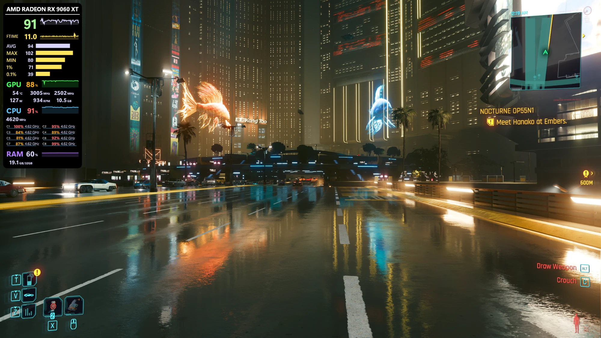
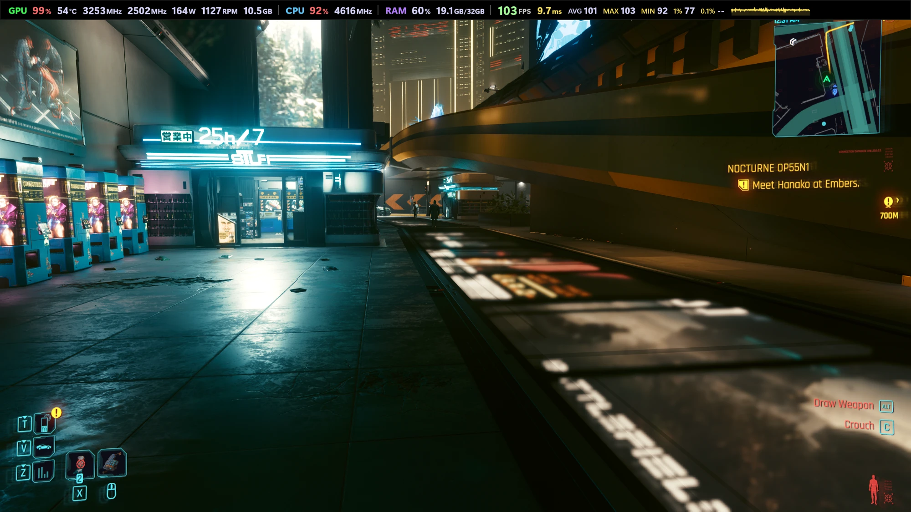
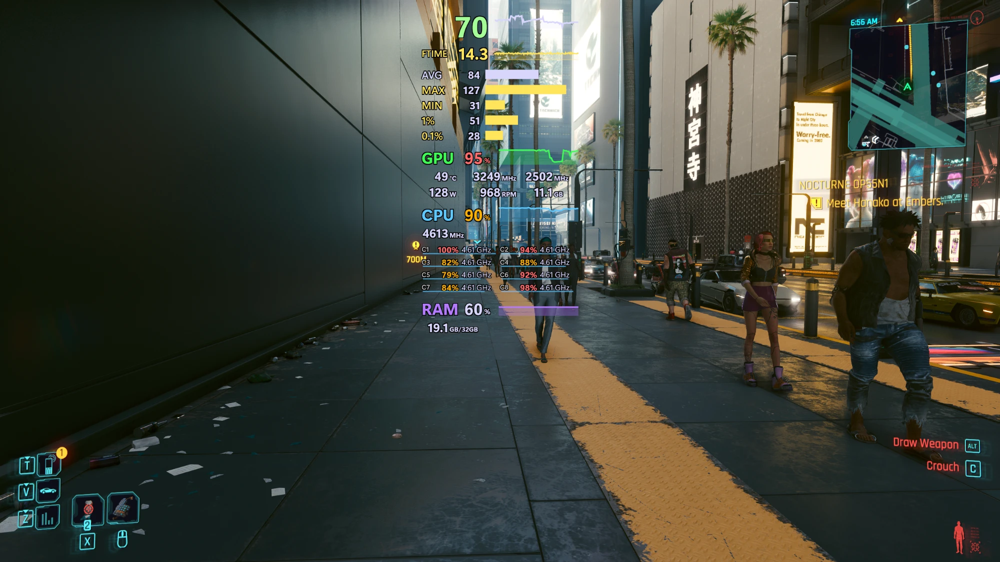
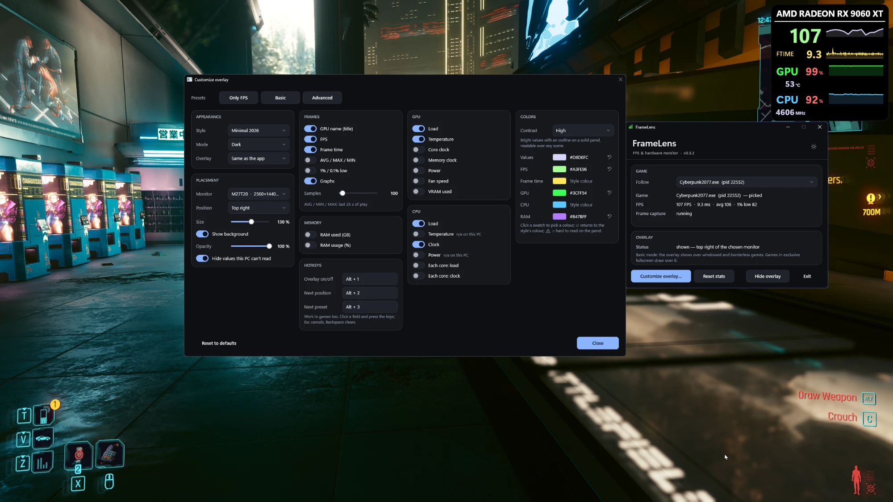

# FrameLens

A free, lightweight FPS and hardware monitor for Windows 10/11 — NVIDIA, AMD and Intel — with no RTSS, Afterburner or HWiNFO required, and no code injected into games.

| | |
|---|---|
|  |  |
| Overlay panel with per-core CPU load and clock | Bar along the top of the screen (SteamOS style) |
|  |  |
| Without a background | Customize overlay, high-contrast values and own colours |

**Download:** the installer is on the [Releases](https://github.com/Olajur/FrameLens/releases) page.

**Status: early development.** The monitoring engine, the overlay, the app windows and the installer work; see:

- [`docs/ARCHITECTURE.md`](docs/ARCHITECTURE.md) — feasibility research, technical limits, stack and module design
- [`docs/ROADMAP.md`](docs/ROADMAP.md) — milestones and exit criteria
- [`docs/FEATURE_STATUS.md`](docs/FEATURE_STATUS.md) — what is done, unverified, planned or unsupported (and why)

## Build (Windows)

Requirements: Visual Studio 2022 (Desktop C++ workload, Windows 10/11 SDK), CMake ≥ 3.21.

```bat
cmake -S . -B build -G "Visual Studio 17 2022" -A x64
cmake --build build --config Release
ctest --test-dir build -C Release
```

Output: `build\Release\framelens-cli.exe` — a single self-contained exe (static CRT).

**Layout preview (developer tool):** `build\framelens-osd-preview.exe <folder>` renders sample overlay panels (1, 2 and 3 GPUs, 150 % without background) to PNG files offscreen, for checking layouts on a PC that lacks that hardware.

## Installer

```bat
tools\build-installer.bat     :: builds the app, then build\installer\FrameLens-<version>-setup.exe
```

Needs Inno Setup 6 (`winget install --id JRSoftware.InnoSetup --exact --scope user`). The setup wizard lets you choose the install folder and adds a Start-menu shortcut. Optional tasks: a desktop shortcut, *Start FrameLens when I sign in* (also in the tray menu as **Start with Windows**), and *Allow FPS measurement*, which adds you to *Performance Log Users*. FrameLens is uninstalled from **Settings › Apps**. Uninstall asks whether to undo the group membership and whether to delete your overlay settings.

## Run

Frame capture uses ETW, which needs **administrator rights** or membership in the built-in **Performance Log Users** group. FrameLens never asks for admin; instead run the one-time setup (one UAC prompt), then sign out and back in:

```bat
tools\setup-etw-access.bat          :: add your account
tools\setup-etw-access.bat status   :: check
tools\setup-etw-access.bat remove   :: undo
```

The script addresses the group by its SID, so it also works on localized Windows where the group name is translated. What this permission allows, and its risks: [`docs/SECURITY.md`](docs/SECURITY.md).

**Desktop app with overlay:** `build\framelens.exe`. It shows the FPS / frame time / AVG-MAX-MIN / GPU / CPU panel at the top-left of the screen with the active window. It has a taskbar button (status window with *Hide overlay* / *Exit*) and a tray icon (FPS in the tooltip). Right-clicking it opens a quick-settings panel: overlay on/off, **Follow**, **Preset**, **Monitor**, **Position**, start with Windows, and the app's actions. It stays open while you change several things and closes when you click elsewhere, switch back to the game, or press Esc. The overlay follows the focused game once it renders. **Customize overlay…** (button, or the tray menu) picks the metrics to show: FPS, frame time, AVG/MAX/MIN, 1%/0.1% lows, graphs; GPU load, temperature, core/memory clock, power, fan, VRAM; CPU load, temperature, clock, power; RAM used and %. It also turns the background on or off and sets its opacity, and its **Size** slider (50–200 %) scales the whole panel, text included. The presets are *Only FPS*, *Basic* and *Advanced*; Advanced shows everything this PC can read. **Appearance** picks a style for the app windows and the overlay: *Classic*, *Sci-Fi 2001* (Vista-era glass and glow), *Matrix* (green terminal with code rain) or *Minimal 2026*, each dark or light (or following Windows; the sun/moon button in the FrameLens window switches quickly). The overlay can use a different style than the app. **Colors** offers *high-contrast values* (solid panel, outlined values, all colours at least 7:1; on by itself when Windows high contrast is on) and own colours for the values, FPS, frame time, GPU, CPU and RAM. **Position** puts it in a corner, in the middle of any side, or makes it a full-width **bar along the top or bottom** of the screen (SteamOS style: GPU | CPU | RAM | FPS in one row). **Monitor** puts the overlay on a chosen screen, or on the screen of the game FrameLens follows (the default); clicking windows on other screens doesn't move it. **Hotkeys** work system-wide, in games too: **Alt+1** shows or hides the overlay, **Alt+2** moves it to the next position, **Alt+3** switches to the next preset. Rebind them in *Customize overlay › Hotkeys*: click a field and press the keys (Esc cancels, Backspace clears). Changes apply live and are saved to `%LOCALAPPDATA%\FrameLens\overlay.ini`. To pin it to one app, use the window's **Follow** dropdown, which lists every process drawing frames right now with its FPS. Choose *Automatic* to follow focus again. Options: `--pid <pid>` to lock onto a process, and `--x <dip> --y <dip>` to move the panel. This is the basic tier (no uiAccess): it shows over windowed and borderless games, not over exclusive fullscreen.

```bat
framelens-cli                 :: live view; follows the focused game once it renders
framelens-cli --pid 12345     :: lock onto a process
framelens-cli --low avg       :: 1%/0.1% lows as average of slowest frames
framelens-cli --json          :: one JSON line per second (for validation / logging)
framelens-cli --interval 500  :: sensor polling interval in ms (min 100)
framelens-cli --no-frames     :: hardware sensors only (no ETW, no elevation needed)
```

Values the hardware/driver can't provide show `n/a`; transient read failures show `--`. FrameLens never estimates or simulates a value.

## Repository layout

```
src/core       data model, FrameStats (portable, unit-tested)
src/sensors    CPU, RAM, GPU (DXGI + PDH + vendor drivers: NVML / ADL / IGCL)
src/frames     ETW frame source over PresentData
src/engine     threads, target selection, snapshot publishing
src/app        framelens-cli
tests          unit tests (run on any OS)
third_party/presentmon   vendored Intel PresentData (MIT) + compat shims — see PATCHES.md
third_party/igcl         vendored Intel Graphics Control Library loader (Intel license, Intel GPUs only) — see its README
third_party/adl-notice   MIT notice for the ADL declarations transcribed in src/sensors/AdlBackend.cpp
```

## Safety

Read-only: never changes clocks, voltages, power limits or fans. No kernel drivers. No injection. No anti-cheat bypassing.

## License

FrameLens: MIT (see `LICENSE`). Third-party: Intel PresentData, MIT (`third_party/presentmon/LICENSE.txt`).
